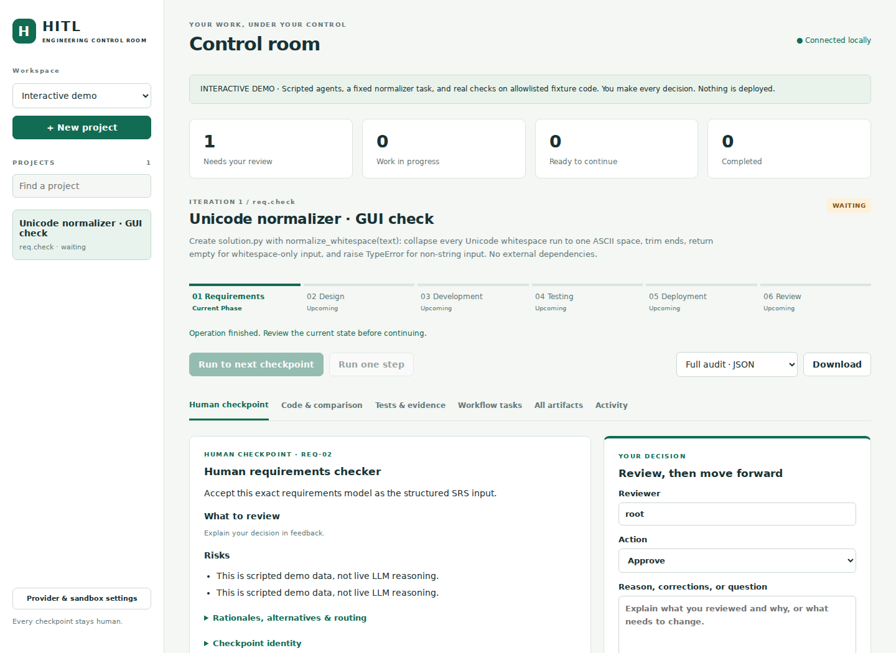
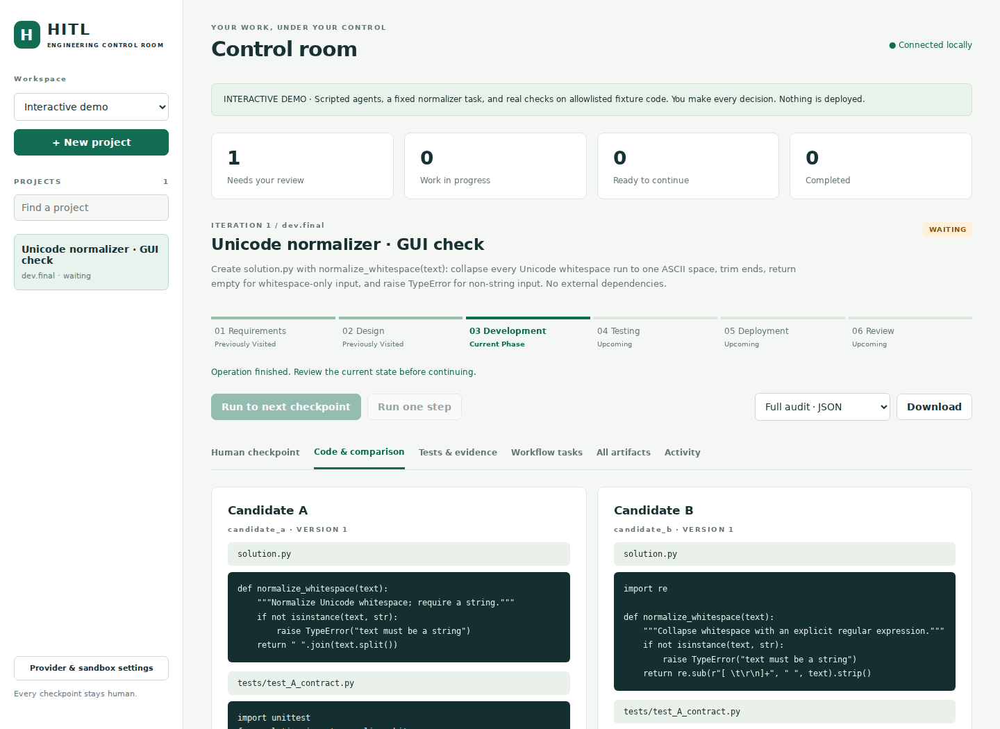

# Graphical control room

## Open it

Install Python 3.11 or newer and extract the entire archive. There are no Python
application dependencies and no Node/build step.

- **Windows:** double-click `Launch_GUI.bat`. It uses the Python launcher, or
  `python` if the launcher is absent. Leave its window open while working.
- **macOS:** open `Launch_GUI.command` with Terminal. If the downloaded archive
  did not retain its executable permission, open `launch_gui.pyw` with Python.
- **Linux:** open `launch_gui.pyw` with Python through your file manager.
- Optional CLI: `python -m hitl_se gui` or `python -m hitl_se.gui`.

A local browser tab opens automatically. The server uses an available port,
listens only on 127.0.0.1, and prints its launch URL in the launcher window as a
fallback. Keep the launcher running. Closing a browser tab does not discard
work. Restart the launcher to reopen saved projects.

The launcher stores live state in `.hitl` and fixed demo state in `.hitl-demo`
beside itself. CLI launches use those paths relative to the current directory.
To share an existing CLI workspace, use:

```bash
python -m hitl_se --workspace /path/to/existing/.hitl gui --live
```

Never put live and demo state in the same directory. The mode selector changes
between those separate workspaces; it does not convert projects or run agents.

## Try the demo

1. Leave **Interactive demo** selected and click **New project**.
2. Name the project. The example goal is fixed: a Unicode whitespace normalizer.
3. Click **Run to next checkpoint**. The engine stops for human review.
4. Open proposal evidence; enter your reviewer name, reasoning and explicit
   selection where requested. Check the acknowledgment and submit your decision.
5. Click **Run to next checkpoint** again to perform the newly authorized work.

At architecture checkpoints choose `library`. At the first development plan
checkpoint choose a plan and explicitly check the bounded evaluation permission.
At the development comparison, candidate B initially fails the Unicode test.
Inspect **Code & comparison** and **Tests & evidence**. You can accept passing A,
or request modifications and renew the displayed evaluation permission to see B
corrected. A failing candidate cannot be accepted.

Testing may revisit plan review when intervention signals fire. Inspect each new
proposal. For the deployment record, choose **Deferred** and explain that no
actual deployment happened. At stakeholder review, enter notes and explicitly
close the iteration or provide new requirements.

The GUI never simulates human decisions. Demo **agents** are scripted and only
exactly allowlisted demo Python source can execute on the host. Live source is
restricted to the Docker runner, as before.

## Screens and operations

| Screen / control | What it does |
|---|---|
| Sidebar and counters | List all projects, current state, work in progress and pending review |
| Run to next checkpoint / Run one step | Advance automated work without skipping human gates |
| Human checkpoint | Full proposal, risks, scope, evidence and state-specific decision forms |
| Approve / Reject / Request modifications | Record feedback and follow the existing workflow's routes |
| Ask for information | Request an explanation while preserving the pending checkpoint |
| Code & comparison | Both candidate source trees, unified diff, independent reviews, canonical source and test bundle |
| Tests & evidence | Per-check outcomes, test plans, raw stdout/stderr, proposed tool scope and sign-off |
| Workflow tasks | Every state across the six workflows, current owner and visited/pending status |
| All artifacts | Complete immutable artifact versions, including prior iterations and explanations |
| Activity | Chronological engine events and human decisions with reasons |
| Recover interrupted work | Recover a failed operation; active leases still prevent premature recovery |
| Request source rework | Return from stopped testing to development planning with corrections |
| Download | Full audit JSON, accepted source ZIP, or testing source ZIP |
| Provider & sandbox settings | Configure live provider/model, Docker image and advanced settings |

Selecting an artifact shows its entire content. Code renders as escaped text,
never executable markup. Feedback is the mechanism for requesting corrections;
accepted and proposed artifacts are immutable, not editable in place.

Task statuses mean **current**, **previously performed**, or **pending /
conditional**. They deliberately do not claim that every earlier task is permanently
complete: feedback loops can revisit states, and some branches are optional.

## Live mode

Switch to **Live projects** and open **Provider & sandbox settings**. Enter the
provider base URL and model, and configure a locally installed, digest-pinned
Python Docker image. The GUI can accept an API key for this server session; it
is held only in memory and never saved to configuration or exports. Alternatively
use the configured environment variable. Advanced JSON supports existing role
overrides, JSON mode, timeouts, lease duration and output bounds. Saving settings
is blocked while GUI jobs are running.

Installing Python/Docker and preparing an image are machine prerequisites, as in
the original prototype. Once prepared, normal project operations require no CLI.
Live calls may incur provider costs. No live API calls or deployments were made
as part of GUI validation.

## State and safety

The GUI uses the same SQLite store, `Engine.decide`, immutable gate digests,
policy guards and execution leases as the CLI. Decisions name the exact displayed
gate and digest; stale submissions fail. Work runs in a background thread per
project. Duplicate GUI jobs for that project are rejected, while other projects
remain inspectable. The database remains authoritative when CLI and GUI coexist.

The browser receives a random server-session capability, not `human.key`. The
capability arrives in the launch URL fragment (never the HTTP request), is removed
from the address bar, and is kept in that tab's session storage. API requests need
it in a header. Exact Host/Origin checks, no CORS, a restrictive content policy,
and text escaping protect the local control surface. Do not share launch URLs.
This is a **single-owner local prototype**, not a remotely hosted multiuser app;
reviewer names are audit attribution, not separately authenticated accounts.

Changing the live configuration in the GUI does not mutate running CLI processes.
External concurrent configuration editing is not coordinated. Decisions are not
automatically followed by more agent work; explicitly use Run to continue.

The app assists with deployment and records what a human did or deferred. It does
not perform deployment. Source export writes a download; it does not modify an
external repository. All original CLI operations remain available.

## Developer verification

Run `python -m unittest discover -s tests -v` for engine, transport, CLI and GUI
HTTP tests. The optional `tests/gui_browser.cjs` exercises the real rendered UI
from project creation through closure, including correction loops and downloads.
It needs Playwright only for development (`npm install --no-save playwright`,
then `npx playwright install chromium` and `node tests/gui_browser.cjs`). It starts
an isolated temporary workspace and does not call a live LLM. Optional
`PYTHON`, `HITL_PLAYWRIGHT_MODULE`, and `HITL_BROWSER_EXECUTABLE` environment
variables select installed verification tools. None are needed to run the app.

Desktop previews from the browser verification:





## If a live agent cites an unknown evidence artifact

Version 0.2.1 supplies exact permitted citation IDs to the model and asks once
for a corrected complete response. It does not rewrite or accept fabricated
citations. If a prior attempt left a project in **Failed**, stop the old GUI,
install the updated source while preserving `.hitl`, restart the GUI, click
**Recover interrupted work**, then **Run to next checkpoint**. The engine
retries that state and keeps all prior approvals and artifacts. A model that
repeats invalid citations after correction still stops the project.

## If an agent returns an unexpected source file field

Version 0.2.2 makes top-level JSON fields explicit for each agent. Source paths
like `battleship/game.py` belong inside the `files` map, and proposed tests
belong inside `test_files`. A malformed schema gets one model regeneration; the
validator still blocks output that remains malformed. To resume an existing
failed project, install the update while preserving `.hitl`, restart the GUI,
re-enter the session API key, click **Recover interrupted work**, then
**Run to next checkpoint**.
